# User Guide

## 1 About this guide

This guide walks through every screen of Inventory Analyzer in the order you meet them when you scan a folder. Each screen has a screenshot with numbered markers, and a table that explains every marked item.

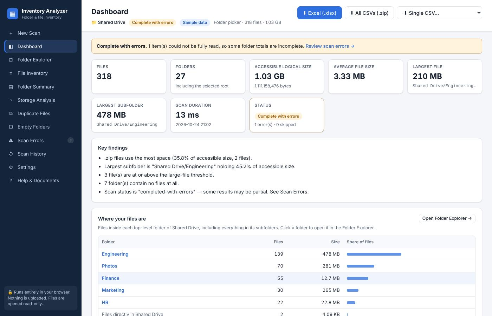

### 1.1 What Inventory Analyzer does

Inventory Analyzer lists every file and folder inside a folder you choose and tells you:

- **how many files each folder holds**, directly and including its subfolders;
- **where each file is**, as a path relative to the folder you chose;
- **what uses the space**: the largest files and folders, and the file types that take the most room;
- **what needs a look**: empty folders, very large files, optional duplicate copies, and anything that could not be read.

The results can be downloaded as one **Excel workbook** or as **CSV files**. Everything runs inside your web browser on your own PC.

For example, after scanning a shared drive you can answer "which folder has the most files?" from the dashboard, open that folder in the **Folder Explorer** to see the files in it, and send the Excel report to the folder's owner.

> [!IMPORTANT]
> **Three rules the application always follows**
>
> - **Read-only.** Your files and folders are only read. Nothing is ever created, changed, moved, renamed or deleted.
> - **Nothing leaves your PC.** The scan runs in your browser. No file, name or result is uploaded anywhere.
> - **No guessing.** A folder that could not be opened is shown as *unknown*, never as empty. A file that could not be compared is *unverified*, never a duplicate.

### 1.2 Who should read it

| Reader | Sections to read |
|---|---|
| Anyone scanning folders | All sections |
| People who only receive the reports | 1, 13 and 17 |
| Administrators who install or share the app | 2, plus the Installation and Administration Guide (IA-IG-02) |
| New users in a hurry | The Quick Start (IA-QS-03), then Appendix A |

### 1.3 How to read the screenshots

Orange numbered markers on a screenshot point to the item described in the matching row of the table below it. The orange outline shows the exact area the marker refers to. Names of buttons and fields are shown in **bold**.

> [!NOTE]
> **Sample data**
>
> Most screenshots use the built-in sample folder, "Shared Drive", with 318 files in 27 folders. Scan History screenshots use a test folder called "Finance Share". All file and folder names are fictional.

### 1.4 Key terms

| Term | Meaning |
|---|---|
| Scan | One run that lists everything inside the folder you chose. Each scan has an ID such as `scan-20261024132104-cbec3c7e`. |
| Selected folder (root) | The folder you chose to scan. All paths start with its name, for example `Shared Drive/Finance/2024/invoice_001.pdf`. |
| Direct | Items immediately inside a folder, not counting its subfolders. |
| Recursive / in total | Items in a folder plus everything in all its subfolders. |
| Relative path | Where a file sits, starting from the selected folder. Browsers do not reveal the full disk path (such as `C:\...`). |
| Logical size | The file size as the browser reports it. It is not the space used on disk. |
| Dot-prefixed item | A file or folder whose name starts with "." such as `.git` or `.gitignore`. |
| Duplicate | Two or more files with exactly the same contents, confirmed by a SHA-256 fingerprint. Same name alone is never a duplicate. |
| Scan history | The list of past scans kept in this browser on this PC. |

## 2 Getting started

### 2.1 Opening the application

There is nothing to install and no sign-in. Open the application in one of these ways (your administrator tells you which one your team uses):

| Way | How | Notes |
|---|---|---|
| Desktop launcher (Windows) | Double-click **Start Inventory Analyzer.bat** | Opens the app in its own Microsoft Edge window. Recommended for everyday use. |
| The HTML file | Open **Inventory Analyzer.html** in Edge or Chrome | The same app, in a normal browser tab. |
| Shared link | Open the link you were sent | The app hosted on claude.ai. If the folder picker is blocked there, use **Upload a folder**. |

The app opens on the **New Scan** screen.

### 2.2 Screen layout

Every screen has the same layout: the menu on the left, the screen title and the open scan's details at the top, and the screen content below. Menu items that need a scan are greyed out until you run one.

| Menu item | What it opens | Needs a scan |
|---|---|---|
| New Scan | Choose a folder and the scan options | No |
| Dashboard | Totals, key findings, where your files are, charts | Yes |
| Folder Explorer | Every folder as an expandable tree with file counts | Yes |
| File Inventory | Every file, with search and filters | Yes |
| Folder Summary | Every folder with direct and recursive counts and sizes | Yes |
| Storage Analysis | Largest files and folders, file types, large files, depth | Yes |
| Duplicate Files | Groups of identical files (when duplicate detection was on) | Yes |
| Empty Folders | Folders with no files anywhere inside | Yes |
| Scan Errors | Anything that could not be read, with what to do | Yes |
| Scan History | Past scans on this PC: open them again or download their reports | No |
| Settings | Default scan options, stored data, privacy and limitations | No |
| Help & Documents | These guides, readable in the app and downloadable as PDF | No |

### 2.3 Which browser to use

Use **Microsoft Edge** or **Google Chrome** on a computer. They support every feature. Firefox and Safari can scan using **Upload a folder**, but they cannot see empty folders. Phones and tablets can view results but are not meant for scanning.

## 3 New Scan

**New Scan** is where every scan starts. Choose the options, then choose the folder.

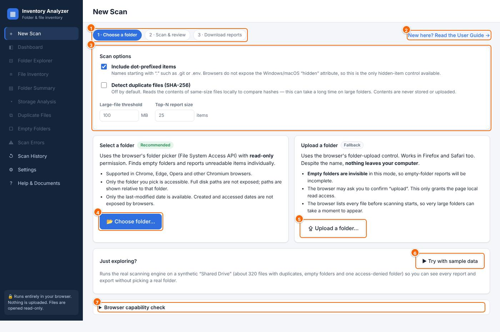

| # | Item | What to do |
|---|---|---|
| 1 | Steps | Shows the three steps: choose a folder, scan and review, download reports. |
| 2 | **New here? Read the User Guide** | Opens this guide inside the app. |
| 3 | Scan options | Settings for this scan. See section 3.1. |
| 4 | **Choose folder…** | Opens the browser's folder picker in read-only mode. The recommended way. Section 3.2. |
| 5 | **Upload a folder…** | The fallback for Firefox, Safari, or when the picker is blocked. Nothing is actually uploaded. Section 3.2. |
| 6 | **Try with sample data** | Scans a built-in fictional "Shared Drive" so you can see every report safely. Appendix A. |
| 7 | Browser capability check | Click to see which features this browser supports. Options the browser cannot support are greyed out. |

### 3.1 Scan options

| Option | Default | What it does |
|---|---|---|
| **Include dot-prefixed items** | On | Includes names starting with "." such as `.git` or `.env`. Turn it off to skip them; skipped items are counted on the dashboard. Browsers do not reveal the Windows or macOS "hidden" attribute, so this is the only hidden-item control. |
| **Detect duplicate files (SHA-256)** | Off | Finds files with identical contents. It reads the contents of files that have the same size, so it can take a long time on large folders. Contents are never stored or uploaded. It switches itself off again for each new session. |
| **Large-file threshold** | 100 MB | Files at or above this size are listed as large files in Storage Analysis and counted in the key findings. |
| **Top-N report size** | 25 items | How many entries the "largest files" and "largest folders" lists show. |

Your choices are remembered in this browser for next time (except duplicate detection). The defaults can be changed in **Settings** (section 15).

### 3.2 Choosing the folder

| | Choose folder… (recommended) | Upload a folder… (fallback) |
|---|---|---|
| Browsers | Edge, Chrome, Opera and other Chromium browsers | All modern browsers, including Firefox and Safari |
| What you see | A folder picker. Pick the folder and confirm "View files". | A file dialog. Pick the folder and confirm "Upload". The browser may list all files before the scan starts. |
| Empty folders | Found and reported | **Not visible** to the app, so empty-folder reports are incomplete |
| Folders that cannot be opened | Reported one by one as Scan Errors | The browser skips them silently |

> [!WARNING]
> **"Upload" does not upload anything**
>
> The browser's word for the fallback is "upload", and it may ask you to confirm an upload. This only gives the page permission to read the folder on your PC. No file leaves your computer.

If you click **Choose folder…** and then close the picker without choosing, nothing happens. If the browser blocks the picker (this can happen on the shared link), a message tells you to use **Upload a folder…** instead.

## 4 Scan progress

The scan starts as soon as you confirm the folder. You can watch it, or switch to another browser tab; it keeps running.

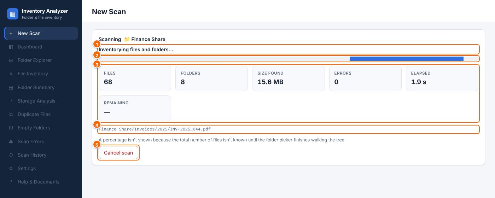

| # | Item | Description |
|---|---|---|
| 1 | Phase | **Inventorying files and folders**, then **Hashing files to confirm duplicates** (only with duplicate detection on), then **Calculating totals**. |
| 2 | Progress bar | Moves back and forth while the total number of files is not yet known. A percentage appears only when there is a real total to measure against, for example while hashing. |
| 3 | Counters | Files, folders and size found so far, errors, elapsed time, and the estimated time remaining when it can be estimated reliably. |
| 4 | Current item | The path being read right now. |
| 5 | **Cancel scan** | Stops the scan. Everything found so far is kept and labelled **Cancelled — partial** on every screen and in the reports. |

A folder of a few thousand files usually takes a second or two. A scan of 26,000 files and 22,000 folders took a few seconds in testing. Duplicate detection adds the time needed to read the candidate files.

## 5 Dashboard

When the scan finishes, the **Dashboard** opens. It answers the main questions at a glance.

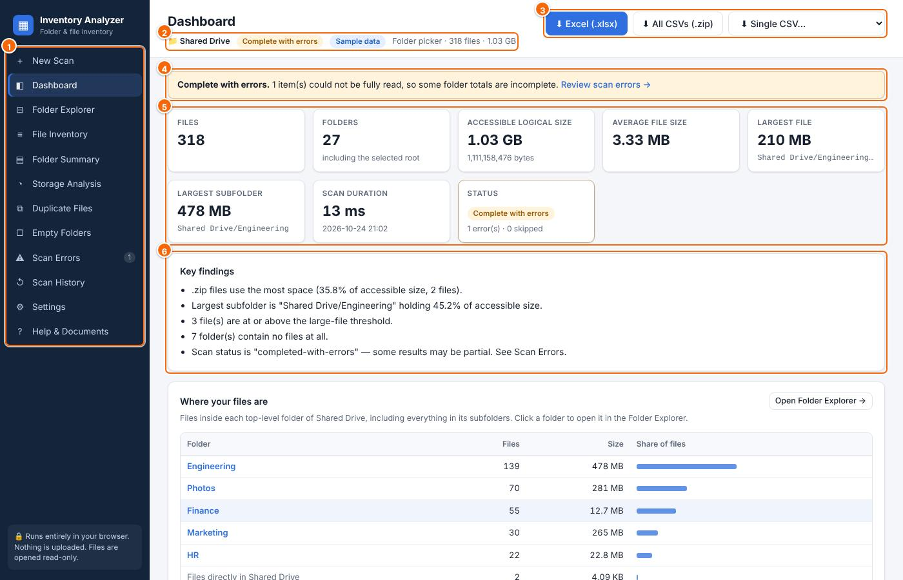

| # | Item | Description |
|---|---|---|
| 1 | Menu | Moves between the screens. **Scan Errors** shows a red count when there are errors; **Duplicate Files** shows the number of groups found. |
| 2 | Scan details | The selected folder, the scan status (section 17), **Sample data** or **Saved scan** labels, the access mode (Folder picker or Folder upload), file count and total size. |
| 3 | Download buttons | **Excel (.xlsx)**, **All CSVs (.zip)** and **Single CSV…**. See section 13. |
| 4 | Status message | Shown when the scan did not complete cleanly, for example "1 item(s) could not be fully read". **Review scan errors** opens Scan Errors. |
| 5 | Totals | Files; folders (including the selected folder); accessible logical size; average file size; largest file and largest subfolder with their paths; scan duration and time; status with error and skipped counts. With duplicate detection on, also the space taken by duplicate copies. |
| 6 | Key findings | Short sentences about what stands out: the file type using most space, the largest subfolder and its share, how many large files and empty folders there are, and a warning if results may be partial. |

### 5.1 Where your files are

Below the key findings, **Where your files are** shows how the files are spread across the top-level folders of the folder you scanned.

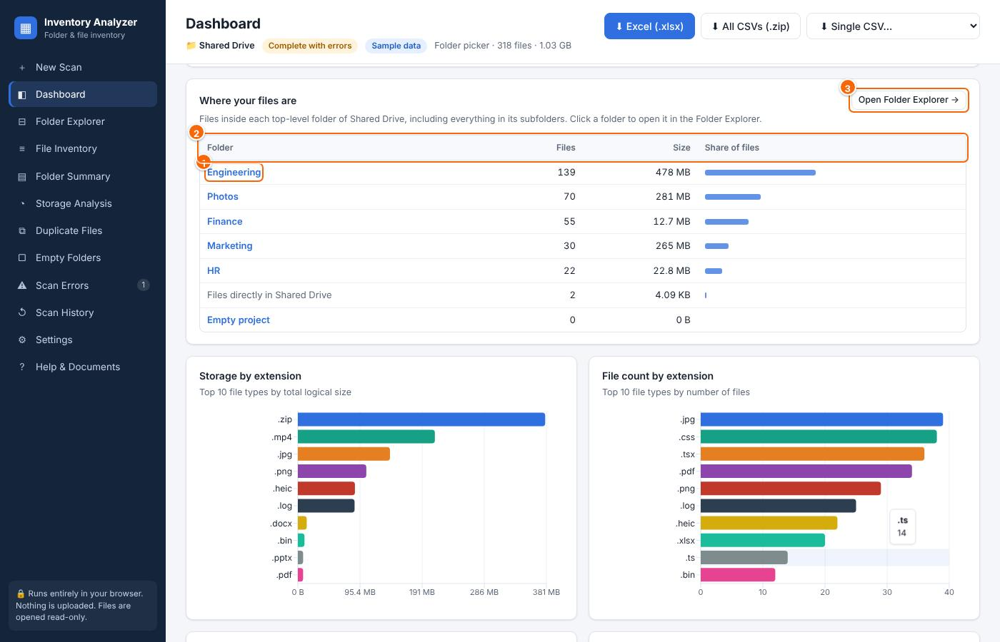

| # | Item | Description |
|---|---|---|
| 1 | Folder name | Click a folder to open it in the Folder Explorer (section 6), already expanded. |
| 2 | Columns | **Files** (in that folder including all its subfolders), **Size**, and **Share of files** as a bar. "Files directly in …" counts files sitting in the selected folder itself. |
| 3 | **Open Folder Explorer** | Opens the full folder tree. |

Up to 15 top-level folders are listed, largest first. If there are more, a link opens the rest in the Folder Explorer. A folder that could not be opened shows "unknown" instead of a count.

### 5.2 Charts

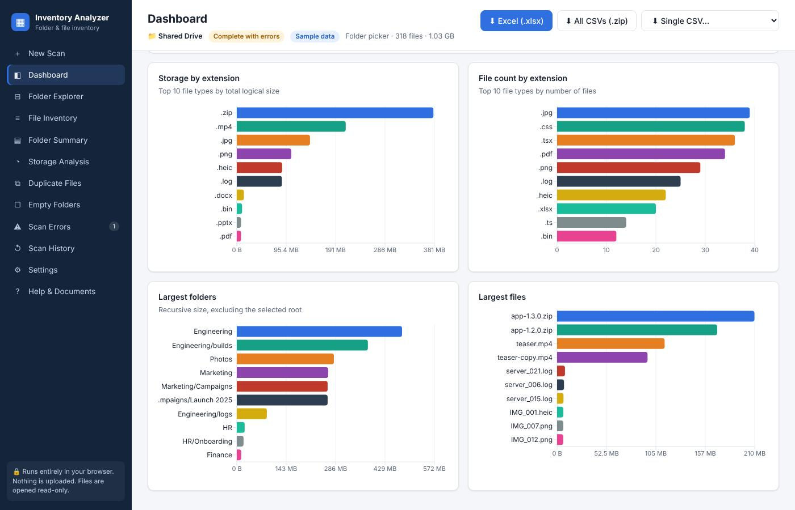

| Chart | Shows |
|---|---|
| Storage by extension | The 10 file types that use the most space |
| File count by extension | The 10 most common file types |
| Largest folders | The 10 largest subfolders by total size (the selected folder itself is left out) |
| Largest files | The 10 largest files |

Hover over a bar to see its exact value.

## 6 Folder Explorer

The **Folder Explorer** shows the scanned folder as a tree, like Windows Explorer, with two counts on every folder. It is the quickest way to see which folder has how many files, and which file is where.

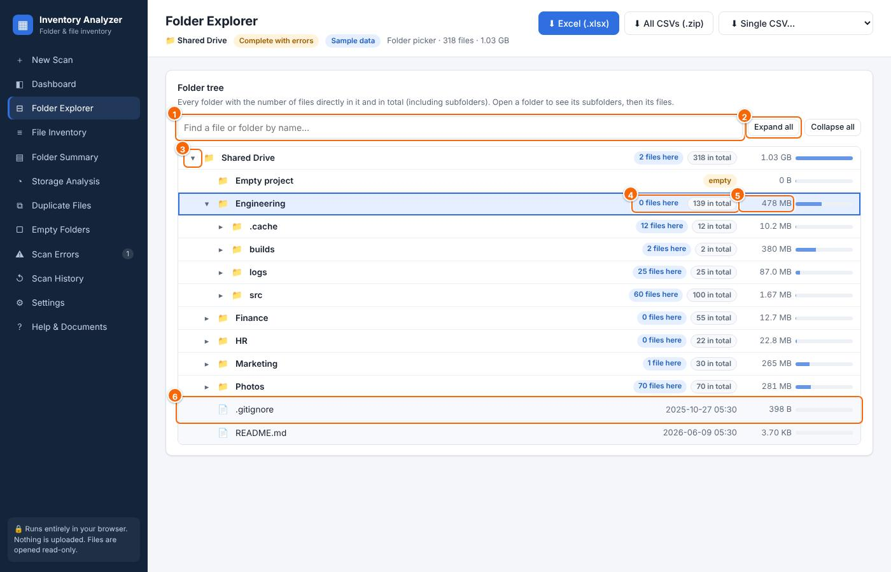

| # | Item | Description |
|---|---|---|
| 1 | **Find a file or folder by name** | Type part of a name. See section 6.1. |
| 2 | **Expand all** / **Collapse all** | Opens or closes every folder at once. |
| 3 | Arrow | Click to open or close a folder. Folders with nothing inside have no arrow. |
| 4 | Counts | **N files here** (blue): files sitting directly in that folder. **N in total** (grey): files in that folder plus all its subfolders. |
| 5 | Size | The folder's total size including subfolders, with a bar showing its share of the whole scan. |
| 6 | File | Files are listed under the folder they are in, after its subfolders, with their date modified and size. |

A folder opened from the dashboard or from **File Inventory** is highlighted. Folders that show **empty**, **no files (only empty subfolders)** or **couldn't be opened** have nothing to count; see section 17.

Very full folders show their first 200 files and a **Show all files (N more)** link.

### 6.1 Finding a file

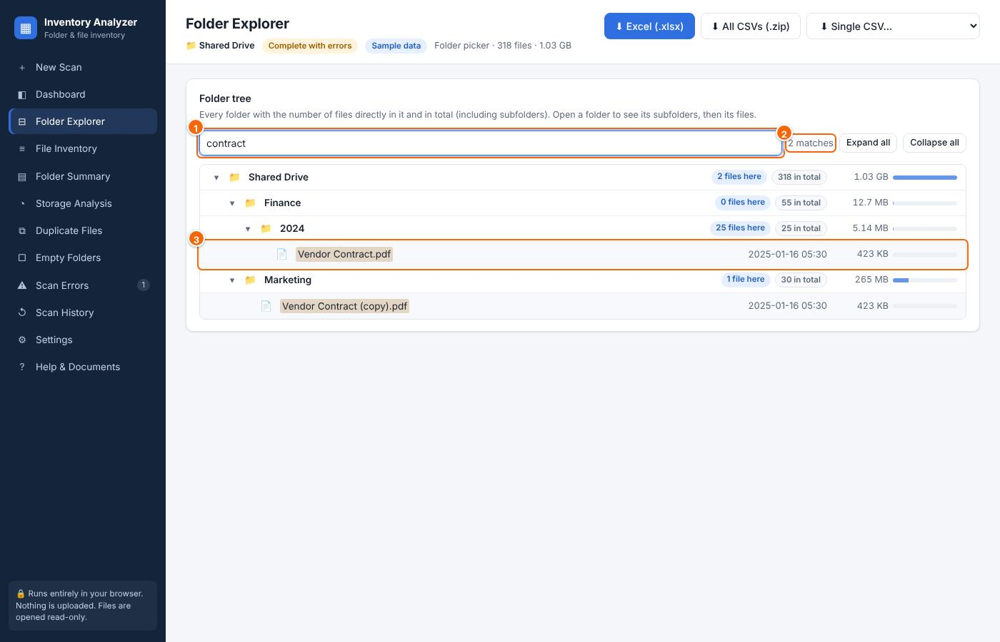

| # | Item | Description |
|---|---|---|
| 1 | Search box | The search is not case-sensitive and matches any part of a file or folder name. |
| 2 | Match count | How many files and folders match. |
| 3 | Match | Matches are highlighted. Only matches and the folders that lead to them are shown, already opened, so you can see exactly where each one is. |

Clear the box to return to the full tree.

## 7 File Inventory

**File Inventory** lists every file found, largest first.

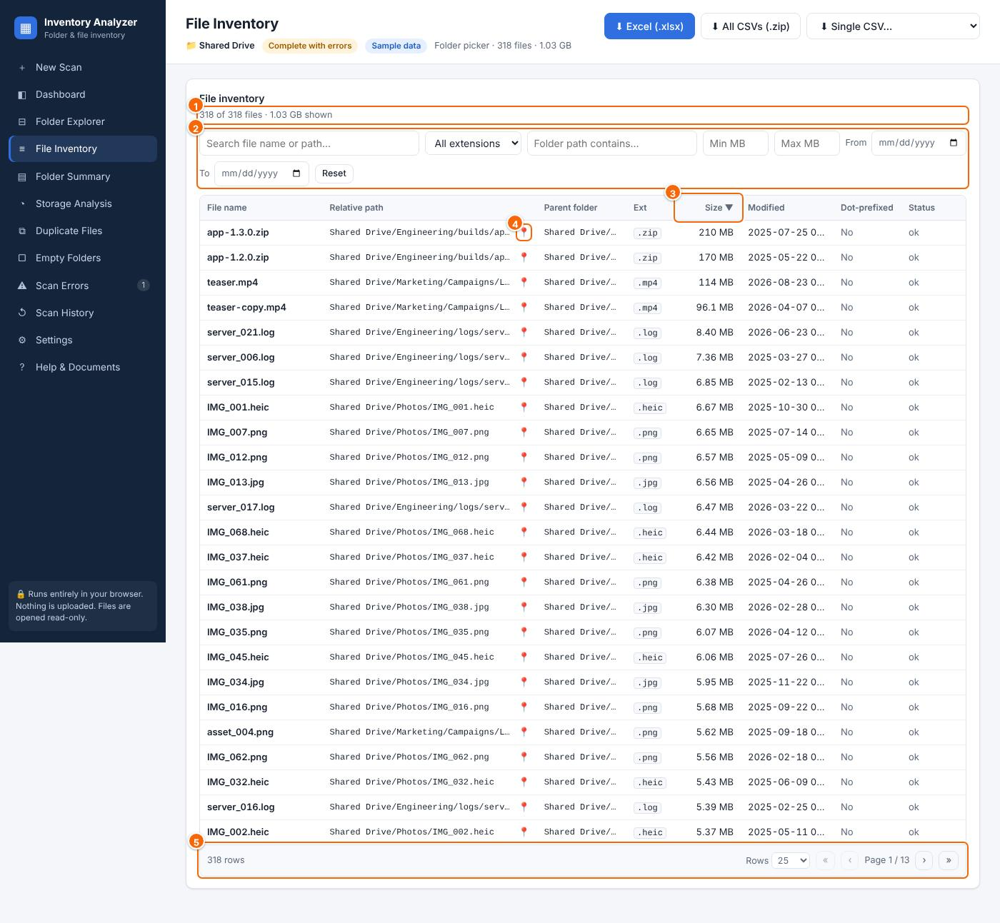

| # | Item | Description |
|---|---|---|
| 1 | Count | How many files match the filters, out of the total, and their combined size. |
| 2 | Filters | **Search file name or path**, **All extensions**, **Folder path contains**, **Min MB** and **Max MB**, **From** and **To** dates (date modified), the duplicate status (when duplicate detection was on), and **Reset** to clear them all. |
| 3 | Column headings | Click a heading to sort by it; click again to reverse. An arrow shows the current sort. |
| 4 | 📍 **Show in folder tree** | Opens the Folder Explorer with this file selected inside its opened folder. |
| 5 | Pages | The number of rows, rows per page (25, 50, 100 or 250) and page buttons. |

The columns are: **File name**, **Relative path**, **Parent folder**, **Ext**, **Size**, **Modified**, **Dot-prefixed**, **Status** (ok, or metadata error when the file's details could not be read) and, with duplicate detection on, **Duplicate**. Hover over a cut-off path or size to see it in full.

When you open a folder from **Folder Summary**, File Inventory shows an **In folder** chip with that folder's path. It lists the files in that folder and all its subfolders. Click ✕ on the chip to show all files again.

## 8 Folder Summary

**Folder Summary** lists every folder with its counts and sizes, largest first.

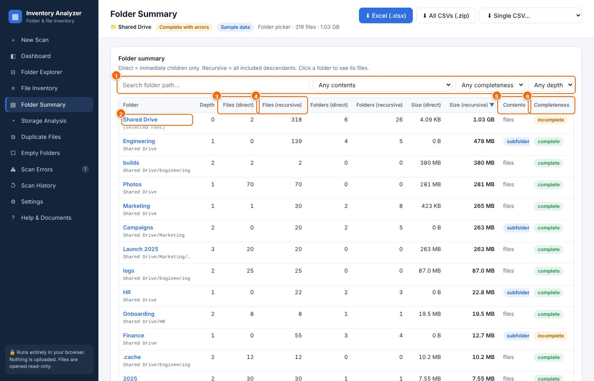

| # | Item | Description |
|---|---|---|
| 1 | Filters | **Search folder path**, **Any contents**, **Any completeness** and **Any depth**. |
| 2 | Folder | The folder name, with its parent path below. Click the name to see its files in File Inventory. |
| 3 | Direct columns | **Files (direct)**, **Folders (direct)** and **Size (direct)**: only what sits immediately inside the folder. |
| 4 | Recursive columns | **Files (recursive)**, **Folders (recursive)** and **Size (recursive)**: everything inside, at any depth. |
| 5 | **Contents** | How full the folder is: files, subfolders only, empty tree, empty, or unknown. See section 17. |
| 6 | **Completeness** | **complete**, or **incomplete** when the folder or something inside it could not be fully read, or the scan was cancelled. Totals of an incomplete folder may be too low. |

**Depth** is how far down the folder is: the selected folder is depth 0, its subfolders depth 1, and so on.

## 9 Storage Analysis

**Storage Analysis** shows where the space goes.

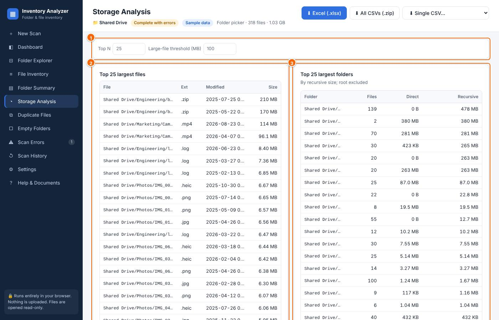

| # | Item | Description |
|---|---|---|
| 1 | **Top N** and **Large-file threshold (MB)** | Change these to change the lists below straight away. They start at the values chosen for the scan. |
| 2 | Top N largest files | The largest files with path, extension, date modified and size. |
| 3 | Top N largest folders | The largest folders by total size, with file count, direct size and total size. The selected folder itself is left out. |

Further down the page:

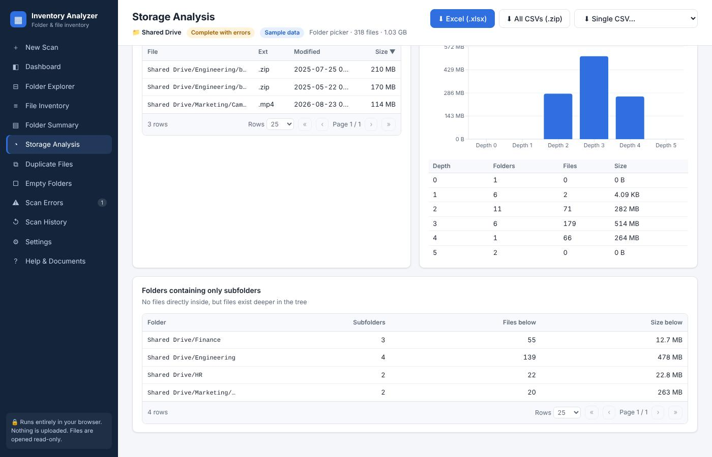

| Section | What it shows |
|---|---|
| Extension summary | Every file type with number of files, total size, percentage of all space, average and largest size |
| Large files (≥ N MB) | Every file at or above the large-file threshold, with their number and total size |
| Distribution by depth | A chart and table of folders, files and size at each depth |
| Folders containing only subfolders | Folders with no files directly inside but files deeper down, often unnecessary nesting |

## 10 Duplicate Files

Duplicate detection is **off** by default because it reads the contents of files. When it was off for the open scan, this screen says so and offers **Set up a scan with duplicate detection**, which turns the option on and returns to New Scan.

When it was on:

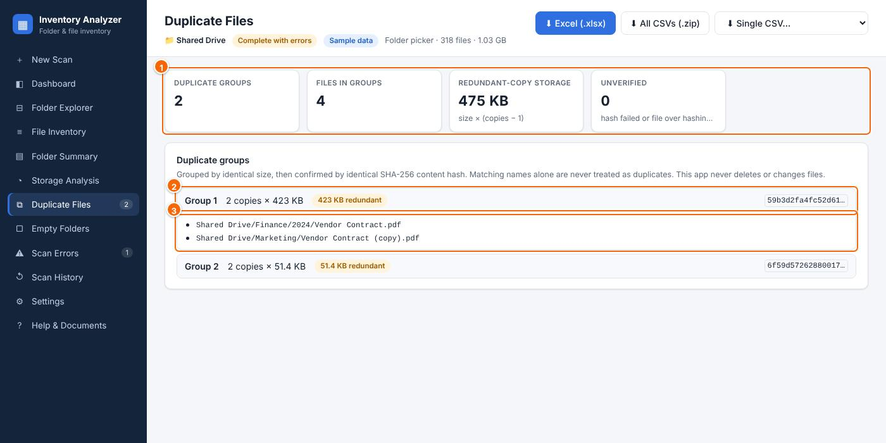

| # | Item | Description |
|---|---|---|
| 1 | Totals | **Duplicate groups**, **Files in groups**, **Redundant-copy storage** (the space you would free by keeping one copy of each) and **Unverified** files. |
| 2 | Group | One set of identical files: number of copies, size of each, space taken by the extra copies, and the start of the SHA-256 fingerprint. Click to open the group. |
| 3 | Copies | The path of every copy in the group. |

How duplicates are found: files are first grouped by size. Only files that share a size are read and fingerprinted (SHA-256). Files are duplicates only when their fingerprints match. Empty (0-byte) files are not compared. A file that could not be read, or is larger than the hashing size limit in Settings, is marked **unverified**. The app never deletes or changes a duplicate; deciding what to keep is up to you.

## 11 Empty Folders

**Empty Folders** lists folders that hold no files anywhere inside them.

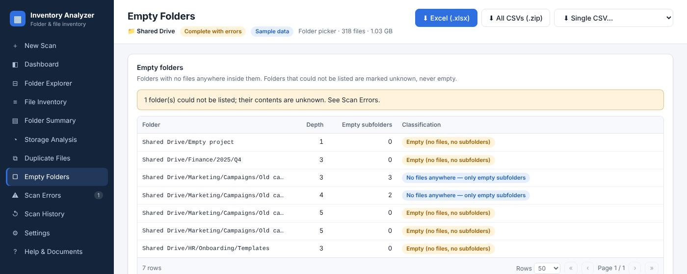

| Column | Description |
|---|---|
| Folder | The folder's relative path |
| Depth | How far down the tree it is |
| Empty subfolders | How many (empty) folders it contains |
| Classification | **Empty (no files, no subfolders)**, or **No files anywhere — only empty subfolders** |

A folder that could not be opened is never listed here; it is shown as unknown and appears in Scan Errors. After a scan with **Upload a folder…**, a warning reminds you that empty folders cannot be seen in that mode.

## 12 Scan Errors

**Scan Errors** lists everything that could not be read, with a hint on what to do.

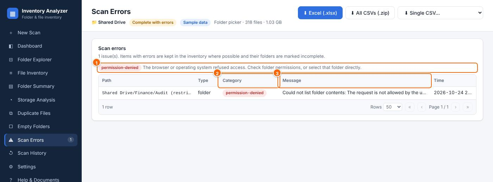

| # | Item | Description |
|---|---|---|
| 1 | Hint | One line per kind of error explaining the likely cause and the fix. |
| 2 | **Category** | The kind of error. See the table below. Use the category list above the table to filter when there are several kinds. |
| 3 | **Message** | The browser's own message. |

| Category | Meaning | What to do |
|---|---|---|
| permission-denied | The browser or Windows refused access | Check the folder's permissions, or scan that folder on its own |
| not-found | The item was moved, renamed or deleted during the scan | Scan again |
| not-readable | The file is locked by another program | Close the program (for example Outlook or an open Office file) and scan again |
| enumeration-failed | A folder's contents could not be listed | Its folder and the folders above it are marked incomplete; scan it on its own |
| metadata-unavailable | A file's size or date could not be read | The file is still listed, with "metadata error" |
| hash-failed | A file could not be read for duplicate checking | It is marked unverified |
| hash-skipped-too-large | A file is above the hashing size limit | Raise the limit in Settings if you need it checked |
| cancelled | You stopped the scan | The results cover only what was found before you cancelled |

Files and folders with errors stay in the inventory wherever possible.

## 13 Downloading the reports

The download buttons are at the top right of every results screen.

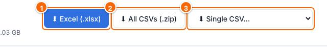

| # | Item | Description |
|---|---|---|
| 1 | **Excel (.xlsx)** | One workbook with every report as a separate sheet. |
| 2 | **All CSVs (.zip)** | A ZIP file with one CSV file per report. |
| 3 | **Single CSV…** | Pick one report from the list to download it as a CSV file. The list shows each report's row count. |

Files are saved to your **Downloads** folder (on the shared link, the browser asks you to confirm each save). They are named after the folder and the scan date, for example `Shared_Drive_inventory_2026-10-24.xlsx` and `Shared_Drive_inventory_2026-10-24_csv.zip`. A message confirms each download. For Excel it also says how many sheets and rows were written and that every sheet's row count matched the scan.

### 13.1 What the Excel workbook contains

| Sheet | Contents |
|---|---|
| Executive Summary | The selected folder, scan ID, access mode, status, start and end time, duration, totals, largest file and subfolder, errors, skipped items, maximum depth, the scan settings and the key findings |
| Folder Tree | The whole tree, indented by level, folders in bold: each folder with files here and files in total, and each file under its folder with its size and path |
| File Inventory | One row per file: ID, name, relative path, parent folder, extension, size in bytes and formatted, date modified, dot-prefixed, scan status; with duplicate detection also duplicate status, group and SHA-256 |
| Folder Summary | One row per folder with direct and recursive counts and sizes, contents and completeness |
| Extension Summary | One row per file type with count, total, percentage, average and largest size, and a totals row |
| Largest Files | The top-N files |
| Largest Folders | The top-N folders |
| Duplicate Files | Only when duplicate detection was on: every file in a duplicate group with its group, fingerprint and size |
| Empty Folders | Every empty folder with its classification |
| Scan Errors | Every error with path, type, category, message and time |

Every sheet has frozen headings, filters and sized columns. Sizes are kept in bytes as numbers, so you can add them up. A sheet that would pass Excel's limit of 1,048,576 rows continues on numbered sheets such as "File Inventory (2)"; nothing is cut off. Before saving, the app checks that every sheet has exactly the expected number of rows.

### 13.2 CSV files

The ZIP contains one CSV per report, each named after the folder, for example `Shared_Drive_folder_tree.csv`, `…_file_inventory.csv`, `…_folder_summary.csv`, `…_extension_summary.csv`, `…_largest_files.csv`, `…_largest_folders.csv`, `…_empty_folders.csv` and `…_scan_errors.csv`, plus `…_duplicate_files.csv` when duplicate detection was on. The Executive Summary is in the Excel workbook only. In `folder_tree.csv`, each level is indented by two spaces. CSV files are UTF-8, so names in any language open correctly in Excel. A cell starting with `=`, `+`, `-` or `@` is prefixed with an apostrophe so Excel shows it as text instead of running it as a formula.

## 14 Scan History

**Scan History** keeps every scan you make on this PC, newest first. You can reopen a scan and download its reports later, even after closing the app.

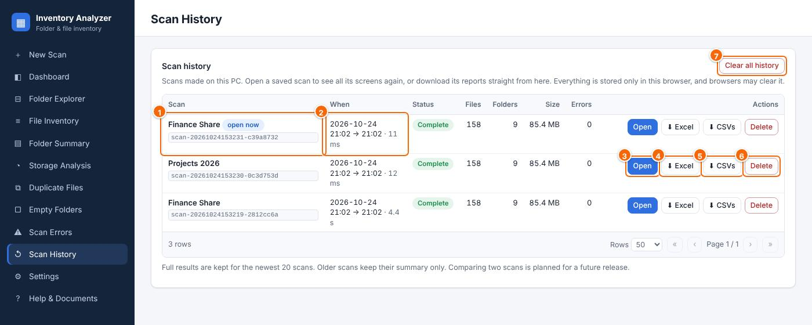

| # | Item | Description |
|---|---|---|
| 1 | Scan | The folder name, **open now** when it is the scan on screen, and the scan ID. |
| 2 | When | The date, start and end time, and how long it took. |
| 3 | **Open** | Opens the saved scan. Every screen, the Folder Explorer and every download work as if it had just run. |
| 4 | **Excel** | Downloads the Excel workbook of that scan without opening it. |
| 5 | **CSVs** | Downloads the CSV ZIP of that scan without opening it. |
| 6 | **Delete** | Removes the scan and its saved results from this PC. |
| 7 | **Clear all history** | Removes every saved scan from this PC. |

The table also shows each scan's **Status**, **Files**, **Folders**, **Size** and **Errors**. Runs of the sample data are not recorded.

> [!NOTE]
> **Summary only**
>
> Full results are kept for the **newest 20 scans**. Older scans, scans made before version 1.2, and scans made while **Keep full results of past scans on this PC** was off keep only their summary row. They show **Summary only**, and their **Open**, **Excel** and **CSVs** buttons are greyed out. Scan the folder again to get its full results back.

### 14.1 Opening the last scan

When you open the app and a saved scan exists, **New Scan** offers it:

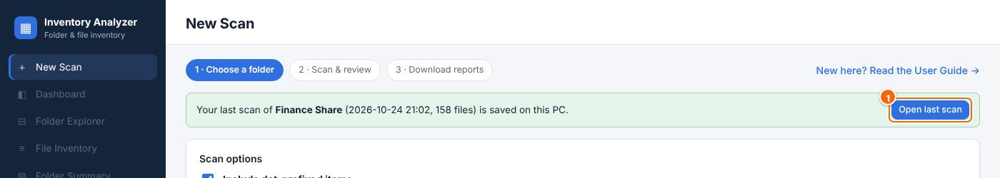

| # | Item | Description |
|---|---|---|
| 1 | **Open last scan** | Opens the most recent saved scan. |

A reopened scan is labelled **Saved scan**, and the dashboard says when it was made:

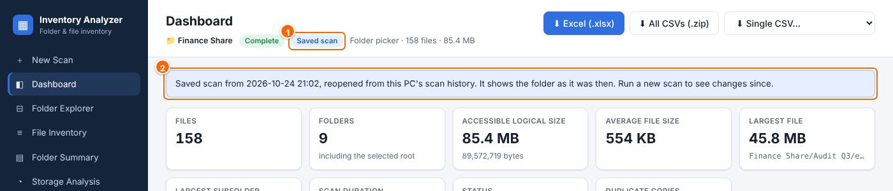

| # | Item | Description |
|---|---|---|
| 1 | **Saved scan** | Shows that this is a stored result, not a fresh scan. |
| 2 | Message | The date of the scan. It shows the folder as it was then; scan again to see changes since. |

> [!WARNING]
> **History lives in this browser**
>
> Scan history is stored in this browser on this PC only. A private (InPrivate) window, clearing browsing data, or low disk space can remove it. The desktop launcher and the shared link each keep their own history. Download the reports you need to keep.

## 15 Settings

**Settings** holds the default options and explains what the app stores.

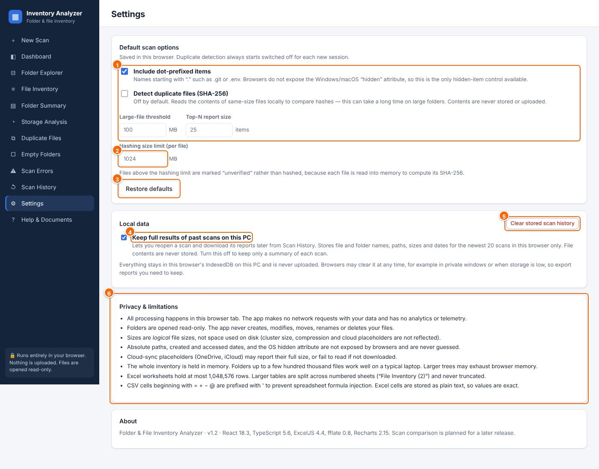

| # | Item | Description |
|---|---|---|
| 1 | Default scan options | The options from section 3.1, used for every new scan in this browser. Duplicate detection always starts switched off. |
| 2 | **Hashing size limit (per file)** | Files larger than this (default 1,024 MB) are not fingerprinted and are marked unverified, because each file is read into memory to fingerprint it. |
| 3 | **Restore defaults** | Puts every option back to its default. |
| 4 | **Keep full results of past scans on this PC** | On by default. Keeps file and folder names, paths, sizes and dates of the newest 20 scans so they can be reopened (never file contents). Turn it off to keep only a summary of each scan. |
| 5 | **Clear stored scan history** | Removes all saved scans from this PC. |
| 6 | Privacy & limitations | What the app does and does not do, and the limits of what a browser can see. |

The **About** panel at the bottom shows the version.

## 16 Help & Documents

**Help & Documents** carries all seven guides inside the app, so they are available wherever the app is, without a network connection.

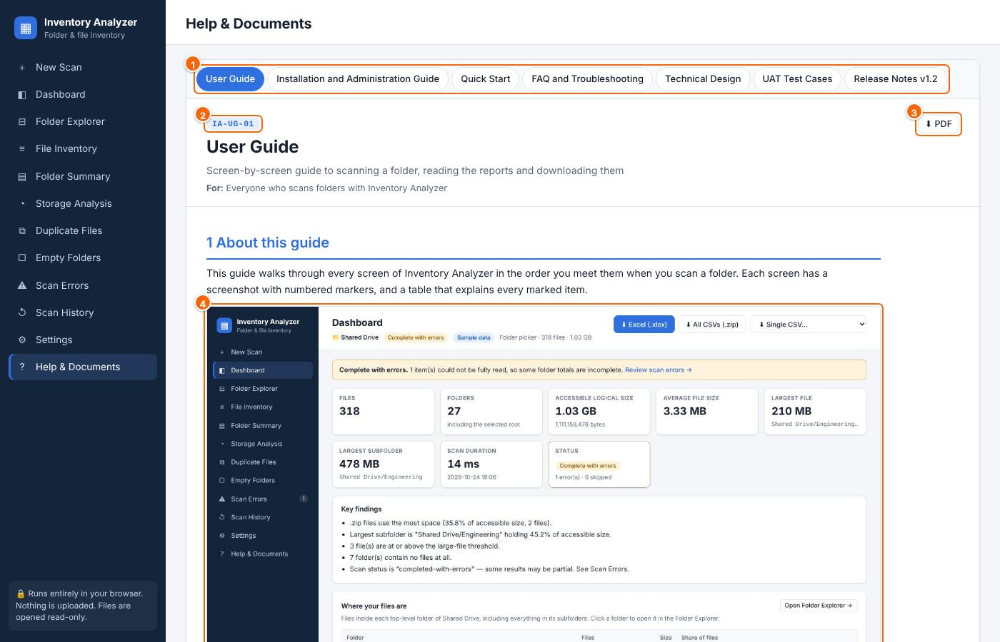

| # | Item | Description |
|---|---|---|
| 1 | Tabs | One tab per guide: User Guide, Installation and Administration Guide, Quick Start, FAQ and Troubleshooting, Technical Design, UAT Test Cases and Release Notes. |
| 2 | Document ID | The guide's ID (for example IA-UG-01), title, purpose and intended readers. |
| 3 | **PDF** | Downloads the open guide as its formatted PDF, with cover, contents and page numbers. |
| 4 | Screenshots | The guide is readable on screen, including every screenshot. |

## 17 Status reference

### 17.1 Scan status

| Status | Meaning | What to do |
|---|---|---|
| Complete | Every item was read. | Nothing. |
| Complete with errors | The scan finished, but some items could not be read. | Open **Scan Errors**. Totals for folders marked incomplete may be too low. |
| Cancelled — partial | You stopped the scan. | The results cover only what was found before you cancelled. Scan again for full results. |
| Failed | The scan could not run at all, for example the folder disappeared. | Read the message, then scan again. |

### 17.2 Folder contents

| Shown as | Meaning |
|---|---|
| files | The folder has files directly inside it. |
| subfolders only | No files directly inside, but files deeper down. |
| empty tree / no files (only empty subfolders) | Only empty subfolders, no files anywhere inside. |
| empty | Nothing at all inside. |
| unknown / couldn't be opened | The folder could not be listed, so its contents are not known. Never counted as empty. |

### 17.3 Duplicate status of a file

| Status | Meaning |
|---|---|
| not-checked | Duplicate detection was off, or the file is empty (0 bytes). |
| unique | No other file has the same contents. A file with a size no other file has is unique without being read. |
| duplicate | At least one other file has exactly the same contents. The group number shows which files belong together. |
| unverified | The file could not be read, or is above the hashing size limit, so it could not be compared. |

## 18 Glossary

| Term | Meaning |
|---|---|
| SHA-256 | A fingerprint of a file's contents. Identical files have identical fingerprints; different files practically never do. |
| File System Access API | The browser feature behind **Choose folder…**. It gives the page read-only access to the folder you pick. Available in Chromium browsers. |
| Folder upload (`webkitdirectory`) | The browser feature behind **Upload a folder…**. It lists the files of a folder; it cannot see empty folders. |
| IndexedDB | The browser's built-in storage, where scan history is kept on this PC. |
| Web Worker | A background thread that runs the scan so the screen stays responsive. |
| Logical size | The size of a file's contents. Disk use can differ because of cluster size, compression or cloud placeholders. |
| Cloud placeholder | A OneDrive or iCloud file that is listed but not downloaded to the PC. It may report its full size, or fail to read. |
| CSV | A plain-text table format that Excel and most other tools can open. |

## 19 Appendix A: practise with sample data

The sample folder "Shared Drive" is built into the app. It is generated fresh in memory each time and does not touch any real folder. It contains duplicates, empty folders and one folder that refuses access, so every screen has something to show.

1. On **New Scan**, keep the default options and click **Try with sample data**.
2. The dashboard should show **318** files, **27** folders, **1.03 GB**, status **Complete with errors**, 1 error and 0 skipped.
3. **Where your files are** should list Engineering 139 files, Photos 70, Finance 55, Marketing 30, HR 22, files directly in Shared Drive 2, and Empty project 0.
4. Open **Folder Explorer**, type `contract` in the search box: two matches, in `Finance/2024` and `Marketing`.
5. **Empty Folders** should list 7 folders. **Scan Errors** should list 1 error: `Shared Drive/Finance/Audit (restricted)`, permission-denied.
6. Go back to **New Scan**, tick **Detect duplicate files (SHA-256)** and click **Try with sample data** again. **Duplicate Files** should show 2 groups, 4 files and 475 KB of redundant copies.
7. Click **Excel (.xlsx)** and open the workbook from your Downloads folder.

Sample runs are not saved in Scan History. To practise with history, scan any small folder of your own: the scan is read-only and nothing leaves your PC.
